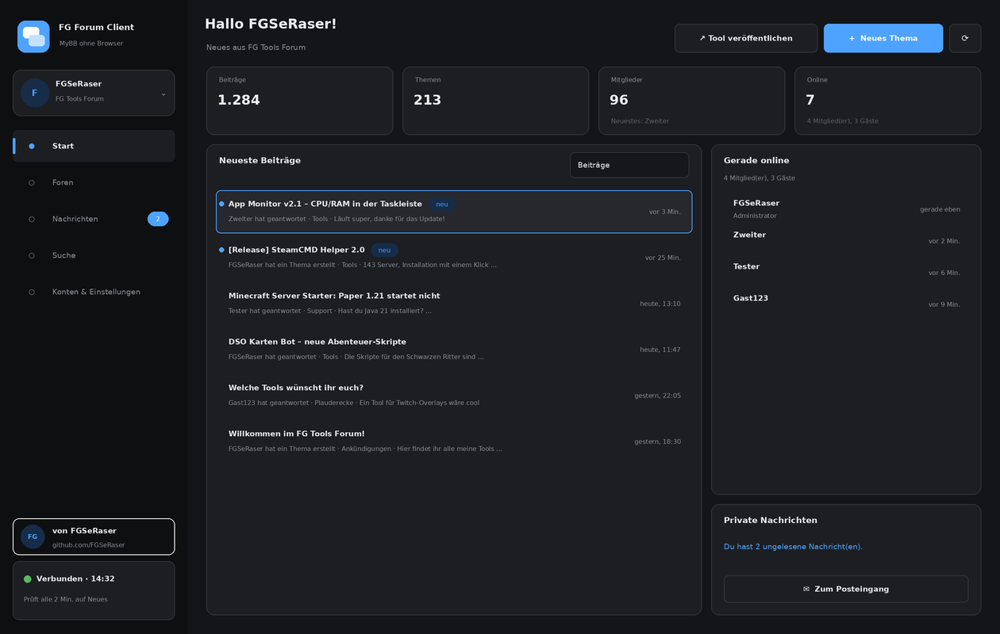
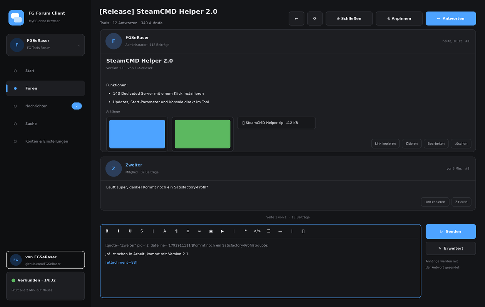

# FG Forum API + FG Forum Client für MyBB

von **[FGSeRaser](https://github.com/FGSeRaser)**

Mit dem Plugin bekommt dein MyBB-Forum eine REST-API. Dazu gibt es einen Windows-Client: Damit liest und schreibst du im Forum, **ohne dich im Browser einzuloggen**.




*(Die Bilder sind Vorschauen des Designs.)*

---

## Was alles geht

| | Plugin / API | Client |
|---|---|---|
| Login mit Benutzername + Passwort | ✅ (Token, läuft nach X Tagen ohne Nutzung ab) | ✅ |
| Login mit API-Key (für Bots und Tools) | ✅ Keys im Benutzer-CP oder im Client erstellen | ✅ |
| Mehrere Benutzer und mehrere Foren | ✅ jeder Benutzer hat eigene Keys und Sitzungen | ✅ Kontowechsel mit einem Klick |
| Foren, Themen, Beiträge lesen (mit Seiten) | ✅ inklusive Unterforen, Präfixe, angepinnte Themen | ✅ |
| Neueste Beiträge / neueste Themen | ✅ | ✅ Startseite, neue Beiträge sind markiert |
| Thema erstellen, antworten, bearbeiten, löschen | ✅ über den MyBB-Kern (PostDataHandler) | ✅ mit Live-Vorschau |
| Datei- und Bild-Upload als Anhang | ✅ gleiche Regeln wie im Forum | ✅ **Drag & Drop und Strg+V (Screenshots)** |
| Anhänge herunterladen, Bilder anzeigen | ✅ mit Rechteprüfung | ✅ Bilder direkt im Beitrag |
| Private Nachrichten (lesen, senden, löschen) | ✅ | ✅ |
| Suche (Titel / Text, Forum, Autor) | ✅ | ✅ |
| Wer ist online, Statistiken, Profile | ✅ | ✅ |
| Moderation: schließen, öffnen, anpinnen | ✅ nur mit Moderatorrechten | ✅ |
| Benachrichtigungen | – | ✅ im Infobereich bei neuen Beiträgen und PNs |
| Entwürfe | – | ✅ werden automatisch gespeichert |
| **Tool-Release-Assistent** | – | ✅ Name, Version, Funktionen, Changelog und Dateien eintragen, daraus wird ein fertiger Beitrag |

Alles läuft über den MyBB-Kern selbst. Rechte, Wortfilter, Moderations-Warteschlange, Beitragszähler, Zusammenführen von Doppelposts, Sperren und das Anhang-Kontingent funktionieren also genau wie auf der Website.

---

## Installation (Plugin)

Voraussetzung: **MyBB 1.8** (getestet mit 1.8.41) und **PHP 7.0 oder neuer**. Datenbank: MySQL/MariaDB, PostgreSQL oder SQLite.

1. Lade den **Inhalt** des Ordners `Upload/` in das Hauptverzeichnis deines Forums hoch (dorthin, wo auch `index.php` und `global.php` liegen):
   ```text
   api/index.php
   api/.htaccess
   inc/plugins/fgapi.php
   inc/plugins/fgapi/api.php
   inc/languages/english/fgapi.lang.php
   inc/languages/deutsch_du/fgapi.lang.php
   inc/languages/deutsch_sie/fgapi.lang.php
   ```
2. Gehe im Admin-CP auf **Konfiguration → Plugins**. Klicke bei **FG Forum API** auf **Installieren & Aktivieren**.
3. Prüfe die Einstellungen unter **Konfiguration → Einstellungen → FG Forum API**:
   - API aktiv
   - Login mit Passwort erlaubt
   - Gruppen mit Zugang
   - Gruppen, die Keys erstellen dürfen
   - Gültigkeit einer Anmeldung
   - Sperre nach Fehlversuchen
   - Nur HTTPS
4. Fertig. Teste das im Browser mit `https://dein-forum.de/api/`. Dort sollte ein JSON mit `"ok": true` erscheinen.

Jeder Benutzer findet im **Benutzer-CP** den neuen Punkt **Forum-Client & API**. Dort sieht er seine Keys und alle angemeldeten Geräte und kann beides widerrufen.

### Update von der alten Version (threads_create.php)

Die alte Version wird komplett ersetzt:

1. Im Admin-CP das alte Plugin **MyBB API** deaktivieren und **deinstallieren**. Dabei wird die Spalte `api_key` aus der Benutzertabelle entfernt.
2. Diese alten Dateien löschen:
   - `api.php` (im Hauptverzeichnis)
   - `api/threads_create.php`
   - `api/classes/`
   - `api/utils/`
   - `api/logs/`
   - `inc/plugins/api.php`
   - `inc/plugins/api/`
3. Danach wie oben installieren.

**Wichtig:** Die alte Version hat API-Keys im Klartext in `api/logs/` geschrieben. Lösche den Ordner auf jeden Fall.

---

## Der Client (Windows)

- Öffne `Client/FG Forum Client.sln` in Visual Studio 2019/2022 und starte mit F5. Du brauchst .NET Framework 4.8, NuGet-Pakete sind nicht nötig.
- Beim ersten Start trägst du ein:
  - die Adresse deines Forums (z. B. `mein-forum.de`)
  - Benutzername und Passwort **oder** einen API-Key
- Dein Passwort wird nie gespeichert. Der Client bekommt einen Token, der mit Windows verschlüsselt abgelegt wird (DPAPI, nur dein Windows-Benutzer kann ihn lesen).
- **Tastenkürzel:**
  - F5 neu laden
  - Alt+← zurück
  - Strg+F Suche
  - Strg+Enter absenden
  - Strg+B / I / U Fett, Kursiv, Unterstrichen
  - Strg+V fügt Screenshots als Anhang ein
- Im Ordner `%AppData%\FG Forum Client\` liegen:
  - die Konten
  - die Einstellungen
  - die Entwürfe

Damit Nutzer Dateien wie `.zip` oder `.exe` hochladen dürfen, müssen diese Dateitypen im Admin-CP unter **Konfiguration → Dateianhang-Typen** erlaubt sein.

---

## Die API

Ein Endpunkt, die Route kommt als Parameter:

```text
GET  https://dein-forum.de/api/?route=forums
POST https://dein-forum.de/api/?route=thread/create     (JSON-Body)
```

**Anmeldung** per Header:
- `X-FG-Token: fgs_…` (aus `auth/login`)
- `X-FG-Key: fgk_…` (API-Key)
- oder `Authorization: Bearer …`

**Antworten** sind immer JSON:

```json
{ "ok": true,  "data": { ... } }
{ "ok": false, "error": { "code": "no_permission", "message": "…", "details": ["…"] } }
```

### Beispiel: Thema mit einem API-Key erstellen

```bash
curl -X POST "https://dein-forum.de/api/?route=thread/create" \
     -H "X-FG-Key: fgk_DEIN_KEY" -H "Content-Type: application/json" \
     -d '{"fid": 2, "subject": "Hallo per API", "message": "[b]Funktioniert![/b]"}'
```

### Beispiel: Bild hochladen und im Beitrag verwenden

```bash
# 1. posthash ausdenken (32 Zeichen a-f, 0-9) und Datei hochladen
curl -X POST "https://dein-forum.de/api/?route=attachment/upload" -H "X-FG-Key: fgk_…" \
     -F "fid=2" -F "posthash=0123456789abcdef0123456789abcdef" -F "file=@bild.png"
# Antwort enthält "aid" und "mycode": "[attachment=15]"

# 2. Thema mit dem gleichen posthash erstellen, der Anhang wird automatisch zugeordnet
curl -X POST "https://dein-forum.de/api/?route=thread/create" -H "X-FG-Key: fgk_…" -H "Content-Type: application/json" \
     -d '{"fid":2,"subject":"Screenshot","message":"[attachment=15]","posthash":"0123456789abcdef0123456789abcdef"}'
```

Alle Routen mit Parametern stehen in **[docs/API.md](docs/API.md)**.

---

## Sicherheit

- Tokens und Keys werden nur als SHA-256-Hash gespeichert und können jederzeit widerrufen werden.
- **Login-Schutz:**
  - Die IP wird nach zu vielen Fehlversuchen gesperrt (einstellbar).
  - Zusätzlich gilt die normale MyBB-Kontosperre.
- Gesperrte, nicht aktivierte und nicht freigegebene Gruppen kommen nicht hinein.
- Passwortgeschützte Foren sind über die API nicht erreichbar.
- Es gibt keine Logs mit Zugangsdaten. PHP-Warnungen landen nicht in der Antwort.
- **Empfehlung:** Benutze die API nur über HTTPS und schalte in den Einstellungen **„Nur über HTTPS“** ein.

---

## Autor

Entwickelt von **FGSeRaser**. Weitere Tools gibt es auf [github.com/FGSeRaser](https://github.com/FGSeRaser).

Lizenz: MIT
